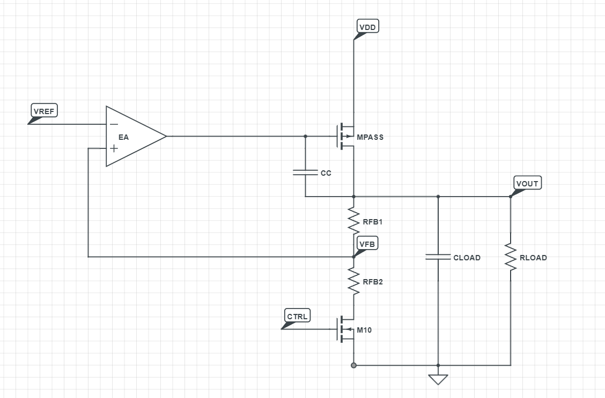
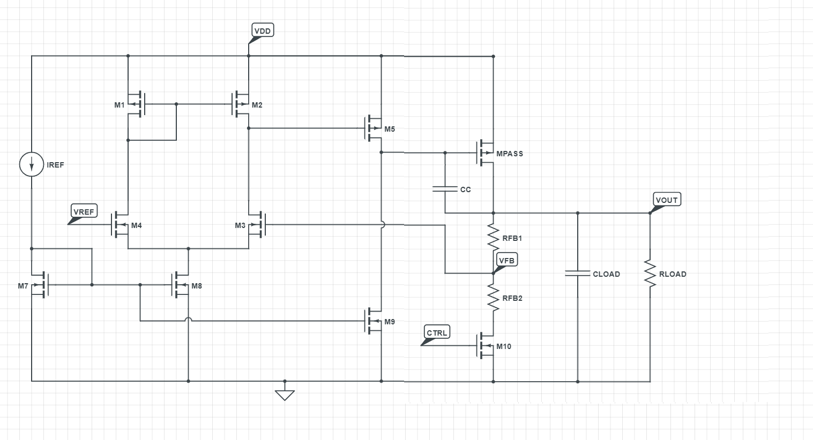
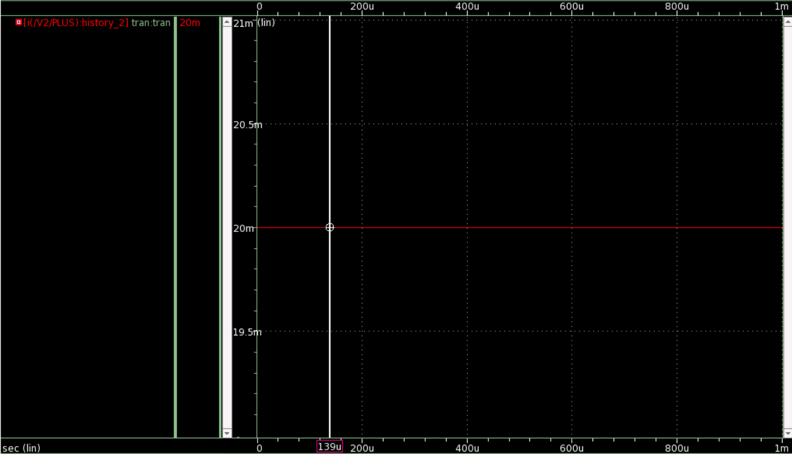
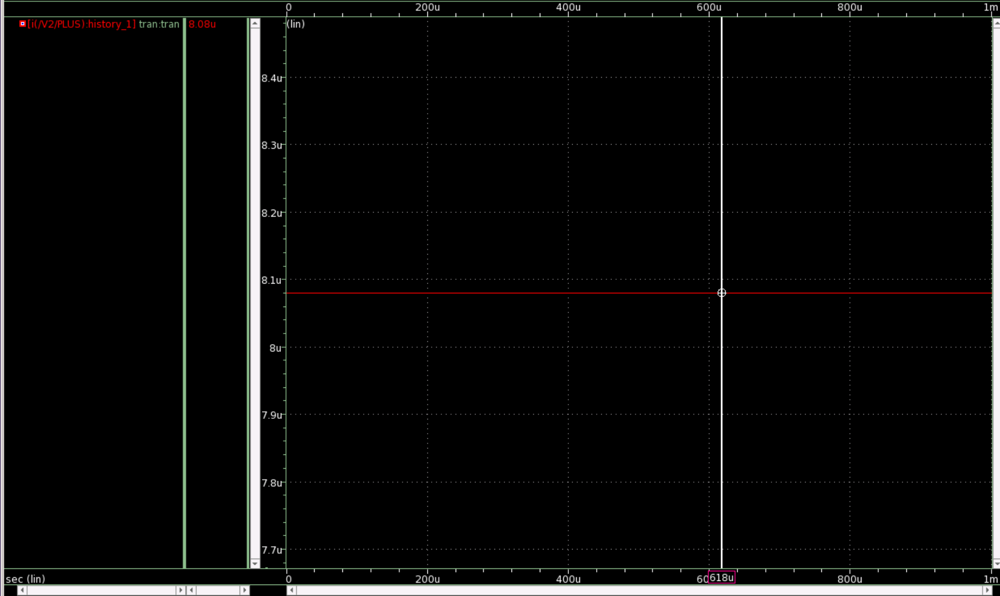
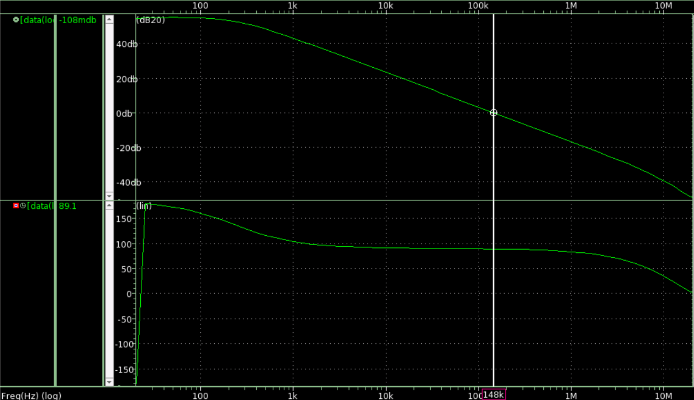
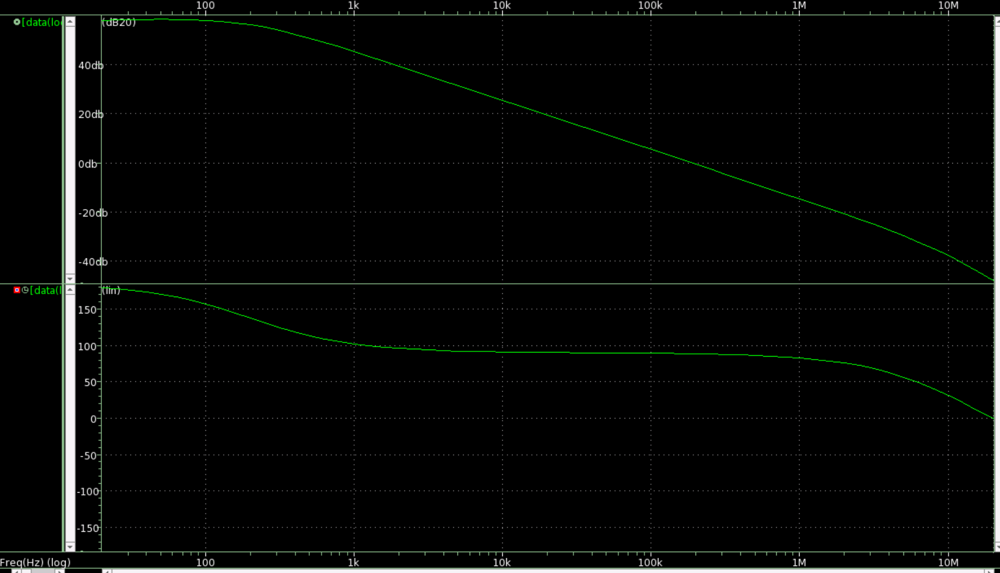
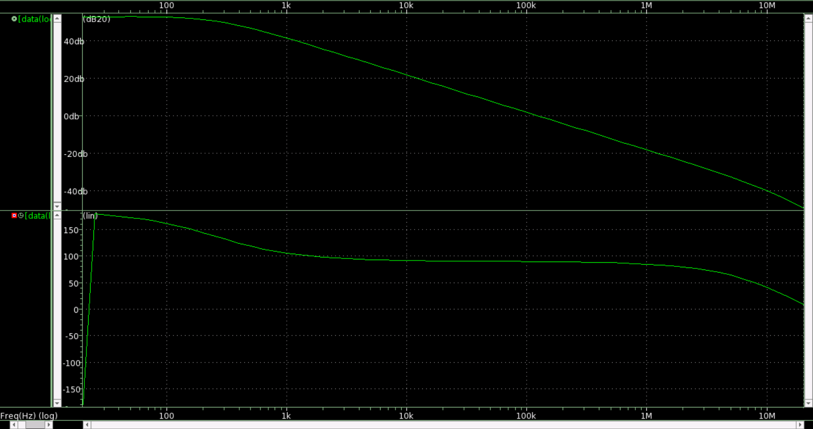
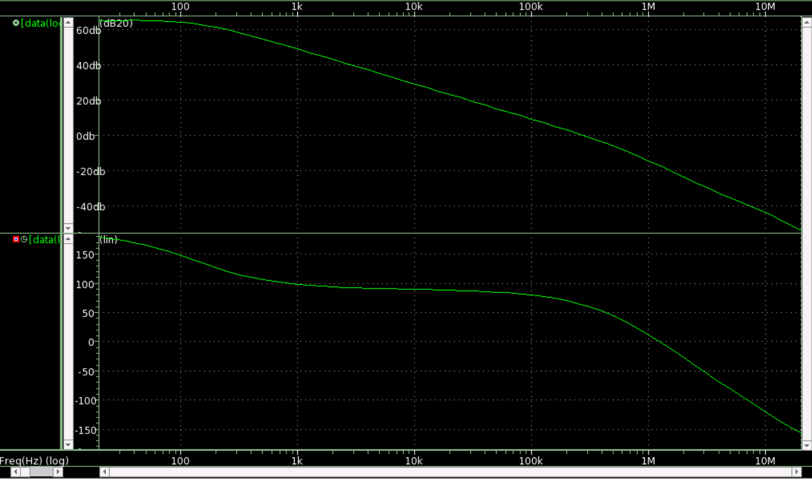
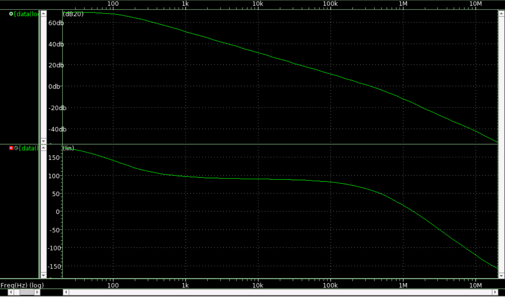
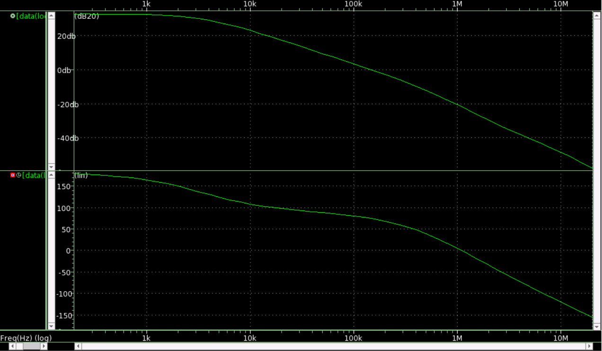

# Adjustable-Low-Dropout-Regulator-with-Miller-Compensation

A 1.0 V-input, digitally adjustable low-dropout regulator that delivers 0.6 V or 0.8 V at up to 20 mA, selected by one control bit. The repo contains the schematic, a reusable error-amplifier sub-circuit, and a set of testbenches for loop stability, regulation, dropout, startup and transients.

---

## Key Specifications

| Parameter | Value |
|---|---|
| Input supply (VDD) | 1.0 V (line-regulation sweep from 0.6 V / 0.7 V) |
| Output voltage | 0.6 V (CTRL = 0) / 0.8 V (CTRL = 1) |
| Maximum load current | 20 mA |
| Load capacitance | 100 pF |
| Reference voltage (VREF) | 0.6 V |
| Error-amplifier bias current (IREF) | 0.1 µA |
| Compensation | Miller capacitor, CC = 30 pF |
| Feedback divider | RFB1 = 20 kΩ, RFB2 = 60 kΩ (10 µA divider current) |
| Verified corners | TT 25 °C, SS −40 °C, FF 125 °C |

## Abstract

A low-dropout (LDO) regulator is a linear voltage regulator that provides a stable DC output from a higher input supply. To meet evolving on-chip power-delivery requirements, this design implements a CMOS LDO that supports two selectable output levels through a single binary control input (CTRL). From a 1.0 V battery input, it provides a default output of 0.6 V and an alternate output of 0.8 V at a maximum load of 20 mA.

## Principle of Operation

A linear regulator steps a supply voltage down to a lower level by dissipating the excess power as heat in a pass device. The gate voltage of the pass element is continuously adjusted by a feedback loop to hold the output constant.

- **Error amplifier.** A high-gain operational amplifier compares a stable reference voltage with the feedback voltage taken from the resistor divider. The amplifier is biased by a current mirror driven by IREF.
- **Gain.** A second-stage common-source amplifier increases the loop gain.
- **Stability.** Miller compensation splits the poles, moving the dominant pole down so that the second pole lies beyond the unity-gain bandwidth, which improves the phase margin.
- **Output stage.** An NMOS pull-down in the amplifier output stage enables rail-to-rail swing, which is valuable in low-voltage, single-supply systems where the output must approach the supply rails.

   
  <b>Figure 1.</b> Top-level schematic of the LDO.

## Reference Circuit

   
  <b>Figure 2.</b> Proposed reference schematic.

## Design Methodology

### 1. Sizing the Pass Element

- The PMOS pass device must carry the full 20 mA load current across all PVT corners while remaining in saturation.
- It is sized for the worst case: maximum load current, minimum VDD, minimum tolerable gate voltage, and the SS corner at −40 °C.
- To avoid over-sizing, its leakage must stay below the maximum current permitted through the resistor divider. This is verified at the FF corner at 125 °C.
- The device is designed to operate from −40 °C to 125 °C.
- Final pass-device parameters: W = 3.48 µm, L = 1.5 µm, nf = 60, m = 196.

   
  <b>Figure 3.</b> Drain current of the pass element at the SS corner (−40 °C): 20 mA.

   
  <b>Figure 4.</b> Leakage current of the pass element at the FF corner (125 °C): 8.08 µA.

### 2. Sizing the Feedback Network

- The divider current is set to 10 µA and VREF to 0.6 V.
- With **CTRL = 0 V**, the bottom NMOS (M10) is off, so no divider current flows and the feedback node equals the output. The output settles at **0.6 V**.
- With **CTRL = 1 V**, M10 conducts and the divider is active:

  VOUT = VREF × (1 + RFB1 / RFB2)

- For VOUT = 0.8 V at 10 µA, RFB1 + RFB2 = 0.8 V / 10 µA = 80 kΩ, which gives **RFB1 = 20 kΩ** and **RFB2 = 60 kΩ**.

### 3. Error Amplifier Design

The closed-loop output follows

  VOUT / VREF = A / (1 + A·B)

where A is the amplifier gain and B is the feedback factor. The minimum gain needed to regulate is:

| VREF | B | VOUT | Required A |
|---|---|---|---|
| 0.6 V | 1.00 | 0.589 V | 54.54 (34.7 dB) |
| 0.6 V | 0.75 | 0.789 V | 95.64 (39.6 dB) |

- The larger value, about 39.6 dB, is the minimum gain target across PVT corners.
- A two-stage amplifier is used to improve both gain and bandwidth.
- The second stage is a common-source amplifier.
- The bias current is 0.1 µA.

   
  <b>Figure 5.</b> Two-stage error amplifier schematic.

## LDO Schematic and Testbench

All blocks are integrated to form the complete LDO. A 30 pF Miller capacitor is added to split the poles and improve the phase margin.

   
  <b>Figure 6.</b> Complete LDO schematic.

   
  <b>Figure 7.</b> LDO testbench.

## Simulation Results

### 1. AC Analysis (Loop Gain and Phase Margin)

**Test condition:** VDD = 1 V, load = 20 mA, CLOAD = 100 pF, CTRL = 0

   
  <b>Figure 8.</b> Loop gain at the TT corner, 25 °C (20 mA load).

   
  <b>Figure 9.</b> Loop gain at the SS corner, −40 °C (20 mA load).

   
  <b>Figure 10.</b> Loop gain at the FF corner, 125 °C (20 mA load).

**Test condition:** VDD = 1 V, load = 20 µA, CLOAD = 100 pF, CTRL = 0

   
  <b>Figure 11.</b> Loop gain at the TT corner, 25 °C (20 µA load).

   
  <b>Figure 12.</b> Loop gain at the SS corner, −40 °C (20 µA load).

   
  <b>Figure 13.</b> Loop gain at the FF corner, 125 °C (20 µA load).

### 2. Transient and DC Analysis

#### Start-up and output selection
**Test condition:** VDD ramps 0 V to 1 V, load = 20 mA, CLOAD = 100 pF, CTRL switches 0 V to 1 V

   
  <b>Figure 14.</b> Start-up and adjustable output voltage (0.6 V / 0.8 V).

#### Line regulation
**Test condition:** VDD = 0.6 V to 1 V, load = 20 mA, CLOAD = 100 pF

   
  <b>Figure 15.</b> Line regulation.

#### Load regulation
**Test condition:** VDD = 1 V, load = 1 mA to 20 mA, CLOAD = 100 pF

   
  <b>Figure 16.</b> Load regulation.

#### Output voltage versus supply
**Test condition:** VDD = 0.7 V to 1 V, load = 2 mA, 10 mA and 20 mA, CLOAD = 100 pF

   
  <b>Figure 17.</b> VOUT versus VDD for different load currents.

#### Line transient
**Test condition:** VDD = 0.7 V to 1 V to 0.7 V, load = 20 mA, CLOAD = 100 pF

   
  <b>Figure 18.</b> Line-transient response.

#### Load transient
**Test condition:** VDD = 1 V, load = 10 mA to 20 mA, CLOAD = 100 pF

   
  <b>Figure 19.</b> Load-transient response.

---

## Author

**Anurag Singh ,** 
**Saiyed Faiez Husnain**

---

## References

1. A. V. Nimkar, S. V. Pattalwar and P. R. Lawhale, "Design of a Programmable Low Drop-Out Regulator using CMOS Technology," *International Journal of Innovative Research in Computer and Communication Engineering*, vol. 3, no. 2, Feb. 2015.
2. I. Vaisband, B. Price, S. Köse, Y. Kolla, J. Fischer and E. G. Friedman, "Distributed LDO regulators in a 28 nm power delivery system," *Analog Integrated Circuits and Signal Processing*, vol. 83, pp. 295–309, Jun. 2015.

